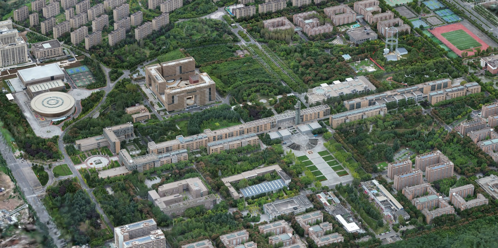

# 西安电子科技大学南校区 3DGS 模型

西安电子科技大学南校区（Xidian University South Campus）的 3D Gaussian Splatting 重建模型，提供完整版与裁切版两个 SOG v2 文件，可直接在浏览器中查看。

> [!IMPORTANT]
> 本项目为个人学习与研究用途的非官方发布，与西安电子科技大学官方无关，不代表学校立场。采集、发布与使用请遵守相关法律法规，模型许可状态见 [MODEL_LICENSE.md](MODEL_LICENSE.md)。

## 下载

| 版本 | Splats | 大小 | 说明 | 下载 |
| --- | ---: | ---: | --- | --- |
| 完整版 | 8,195,476 | 116 MB | 保留完整场景范围 | [xdu-south-campus-full-8.2m.sog](https://github.com/yuhaowang774/xdu-south-campus-3dgs/releases/download/v1.0.0/xdu-south-campus-full-8.2m.sog) |
| 裁切版 | 7,958,807 | 114 MB | 裁切至核心场景，包围盒更紧凑，推荐预览 | [xdu-south-campus-cropped-8.0m.sog](https://github.com/yuhaowang774/xdu-south-campus-3dgs/releases/download/v1.0.0/xdu-south-campus-cropped-8.0m.sog) |

SHA-256 校验和见 [SHA256SUMS](SHA256SUMS)。

## 查看方式

1. 打开 [SuperSplat 在线编辑器](https://superspl.at/editor)。
2. 将 `.sog` 文件拖入页面，或通过 File → Import 导入。
3. 建议先试裁切版，加载更快。

也可以在知天下平台在线查看：[西安电子科技大学南校区作品页](https://3d.explorerglobal.cn/model/zl3043jl)。

SOG 是 PlayCanvas SuperSplat 使用的压缩高斯泼溅格式（v2），支持该格式的 PlayCanvas 应用均可加载。

## 场景信息

- 场景：西安电子科技大学南校区
- 表示：3D Gaussian Splatting，球谐阶数 3
- Splat 数：8.20M（完整版）/ 7.96M（裁切版）
- 训练平台：知天下
- SOG 生成器：splat-transform v3.0.0（完整版）/ v3.9.0（裁切版）
- 坐标：模型使用归一化坐标，未附带地理坐标或真实比例尺

更完整的采集、训练与适用范围说明见 [MODEL_CARD.md](MODEL_CARD.md)。

## 许可

- 仓库内文档与脚本：MIT，见 [LICENSE](LICENSE)
- 模型权重：CC BY-NC 4.0（署名—非商业性使用），见 [MODEL_LICENSE.md](MODEL_LICENSE.md) 与 [LICENSE-MODEL](LICENSE-MODEL)

## 引用

如果本模型对你的工作有帮助，引用信息见 [CITATION.cff](CITATION.cff)。

## 致谢

- 训练平台：知天下
- SOG 格式与查看器：[PlayCanvas SuperSplat](https://github.com/playcanvas/supersplat)
